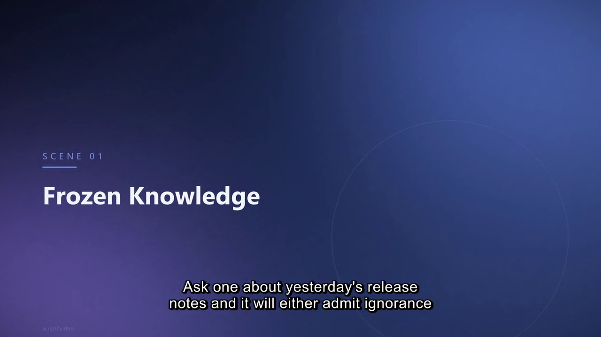
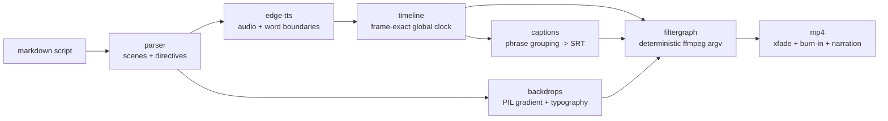

# script2video

[](https://github.com/ssh071102-code/script2video/actions/workflows/ci.yml)
[](LICENSE)
[](pyproject.toml)

Turn a markdown script into a narrated, captioned video: neural TTS with
word-accurate timings, styled burned-in captions, and deterministic ffmpeg
assembly -- one command.



That frame is from [docs/demo.mp4](docs/demo.mp4), an 83-second explainer
rendered entirely by this pipeline from
[examples/demo-script.md](examples/demo-script.md). Every visual is
program-generated (palette-driven gradient compositions, PIL typography,
film grain, Ken Burns motion) -- no stock footage, no downloaded media.

```console
$ pip install git+https://github.com/ssh071102-code/script2video
$ script2video render examples/demo-script.md -o docs/demo.mp4 --crf 26
script2video 0.1.0
script : examples/demo-script.md (5 scenes, voice en-US-AriaNeural)
[1/4] narration  5 synthesized, 0 cached (188 word boundaries) [8.8s]
[2/4] captions   21 cues -> captions.srt [0.0s]
[3/4] backdrops  5 cards at 2560x1440 (2x supersampled) [2.8s]
[4/4] assembly   xfade chain + caption burn-in, crf 26 [8.1s]

scene  start      narration  visual   title
  1       0.00s    17.30s       18.92s   Frozen Knowledge
  2      18.52s    13.03s       14.64s   Retrieval in One Sentence
  3      32.76s    16.20s       17.80s   Chunk, Embed, Store
  4      50.16s    15.22s       16.84s   The Grounded Prompt
  5      66.60s    15.07s       16.68s   Why It Matters
total    83.28s

output : docs/demo.mp4 (3.02 MiB, 83.28s, h264 1280x720 + aac 48000 Hz)
```

This is the assembly and timing layer of a video production system. Feed it
a script; it owns everything between "text on disk" and "valid mp4":
narration, word-accurate captions, generated backdrops, transitions, and a
fully deterministic encode.

## Pipeline



- **TTS**: [edge-tts](https://github.com/rany2/edge-tts) (free, no API key).
  The service streams `WordBoundary` events alongside the audio; both are
  persisted per scene (`.mp3` + `.json`) and cached by a hash of
  `voice | rate | text`, so unchanged scenes are never re-synthesized.
- **Captions**: built directly from those word boundaries -- grouped into
  readable cues by character budget, speech pauses, sentence ends, and a
  max cue duration, then balanced onto two lines. Punctuation is restored
  from the script text (boundary events carry bare words).
- **Visuals**: each scene gets a generated 2x-supersampled card; ffmpeg's
  `zoompan` adds slow zoom/pan (four presets, cycled per scene), `xfade`
  crossfades scenes, and the `subtitles` filter burns the SRT.
- **Assembly**: ffmpeg ships inside the
  [imageio-ffmpeg](https://github.com/imageio/imageio-ffmpeg) wheel -- no
  system install. The full argv is constructed by a pure module.

## Commands

```console
$ script2video render script.md -o out/video.mp4    # full render
$ script2video render script.md --dry-run           # plan only: timings + filtergraph
$ script2video captions script.md -o out/video.srt  # SRT only, same clock as render
```

`--dry-run` prints the scene table, crossfade offsets, and the exact
filtergraph chains without touching ffmpeg. Scenes already in the
narration cache show real durations; uncached scenes show a
words-per-second estimate marked `(est)`.

`captions` emits the same cue times a full render would use, so the SRT
works as a sidecar for a previously rendered video.

## Script format

```markdown
---
title: How Retrieval-Augmented Generation Works
voice: en-US-AriaNeural
palette: midnight
---

## Frozen Knowledge

Narration for the first scene. Every paragraph until the next `##`
heading is spoken.

## Retrieval in One Sentence
<!-- s2v: palette=aurora motion=pan-left -->

More narration.
```

- **Front matter** (optional): `title`, `voice` (any edge-tts voice),
  `palette` (default backdrop palette).
- **`## Heading`** starts a scene; the heading text becomes the card title.
- **Directives** live in an `<!-- s2v: key=value ... -->` comment inside
  the scene:

| key       | values                                              | effect                          |
| --------- | --------------------------------------------------- | ------------------------------- |
| `palette` | `midnight` `ember` `kelp` `slate` `aurora` `dawn`   | backdrop colors for this scene  |
| `motion`  | `zoom-in` `zoom-out` `pan-left` `pan-right`         | Ken Burns preset (else cycled)  |
| `image`   | path relative to the script                         | your image instead of a card    |

Parsing is strict: unknown keys, unknown palettes, empty narration, and
missing image files fail with a line number instead of rendering something
half right.

## How timing works

Scenes crossfade, so the global timeline is shorter than the sum of scene
durations -- and captions, audio delays, xfade offsets, and the final
`-t` must all agree on the same arithmetic. `timeline.py` computes it once:

```
visual[i]          = pad_head + narration[i] + pad_tail   (quantized to whole frames)
video_start[i]     = sum(visual[j] for j < i) - i * fade
narration_start[i] = video_start[i] + pad_head
total              = sum(visual) - (n - 1) * fade
```

Two invariants are enforced rather than hoped for: everything is quantized
to whole frames first (an xfade offset that misses a frame boundary makes a
visible seam), and both pads must be >= the fade so a voice never speaks
through a crossfade. Word timings are shifted by `narration_start[i]` onto
the global clock before cue grouping -- which is also why a caption never
spans two scenes.

## Design notes

**Why word boundaries instead of STT alignment?** The usual way to caption
synthetic narration is to render audio, then run speech-to-text or forced
alignment over it. That adds a model dependency, drifts on numbers and
names, and can mishear the very text you already have. The TTS engine
*knows* when it speaks each word; capturing `WordBoundary` events gives
millisecond-accurate cues for free, offline, with zero chance of
transcription error. The trade-off: caption timing quality is bound to the
TTS metadata, which is exactly the right coupling for synthetic narration.

**Why a pure filtergraph builder?** `filtergraph.py` maps
`(timeline, filenames, settings) -> argv` with no I/O, no randomness, no
clocks. The test suite asserts the *entire* ffmpeg command for known
inputs, so a regression in assembly logic fails a string comparison
instead of shipping a subtly broken video. ffmpeg also runs with `cwd` set
to the working directory and only ever sees bare relative filenames --
which sidesteps Windows path-quoting inside filter strings and keeps the
argv byte-identical across machines.

**Why generated backdrops?** Shipping zero third-party media keeps the
repository clean of licensing questions and keeps the focus on the layer
this tool owns. Cards are rendered at 2x output resolution so `zoompan`
only ever scales down. Titles use a system font chain (Segoe UI / Arial /
DejaVu / Liberation, then Pillow's built-in fallback); no font files are
bundled, and caption burn-in falls back through fontconfig the same way.

## Options

| flag                | default          | notes                             |
| ------------------- | ---------------- | --------------------------------- |
| `-o, --output`      | `out/video.mp4`  | output path (`render`)            |
| `--voice`           | script / Aria    | any edge-tts voice name           |
| `--width, --height` | 1280 x 720       | output resolution                 |
| `--fps`             | 25               | frame rate (timing quantum)       |
| `--crf`             | 23               | x264 quality; demo uses 26        |
| `--fade`            | 0.4              | crossfade seconds                 |
| `--burn/--no-burn`  | burn             | burn captions into the video      |
| `--workdir`         | `.script2video`  | cache + intermediates             |
| `--dry-run`         | off              | print the plan, render nothing    |

## Testing

```console
$ pip install -e ".[dev]"
$ pytest -q
78 passed
```

The suite is fully offline, including an end-to-end test that assembles a
real mp4 from committed fixtures and probes it (stream layout, duration
against the computed timeline, full decode with zero errors). The fixtures
under `tests/fixtures/narration/` are genuine edge-tts output (~47 KB);
regenerate them with `python scripts/refresh_fixtures.py` when the fixture
script changes. Everything else -- parser, timeline math, cue grouping,
SRT formatting, argv construction -- is pure and tested with known-answer
cases.

## Limitations

- **TTS needs the network.** edge-tts calls Microsoft's endpoint; there is
  no offline voice. Narration is cached aggressively, and everything
  downstream of the cache runs offline.
- **Synthetic voices sound synthetic.** Good for explainers and drafts;
  not a voice actor.
- **This is the assembly layer.** Creative direction, model-generated
  footage, music, and mixing sit above it. What this layer guarantees is
  the part that should never be hand-tuned: timing, captions, and a
  reproducible encode.

## License

MIT. Copyright (c) 2026 Laurin Lin.
